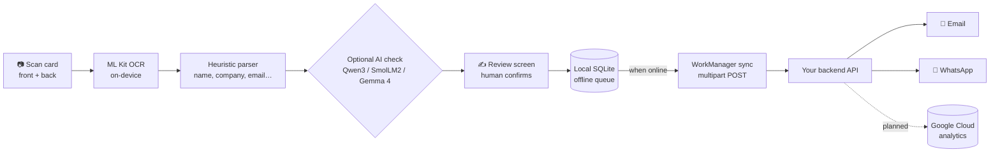

# ExpoCopilot

### Capture. Understand. Connect. Turn conversations into opportunities.

**ExpoCopilot** is an offline-first Android AI assistant for trade shows and expos.
Scan a business card, photograph a product, record a conversation, and let on-device
AI turn the mess into organized leads, meeting notes and next steps, even when the
exhibition network is down.

> Internally the Android app is codenamed **CardDrop** (package `com.tejeet.carddrop`).

---

## The problem

Imagine walking Electronica or the Canton Fair, visiting 100+ stalls in a day,
collecting business cards, photographing products and discussing partnerships.
Nobody can remember every supplier, specification and promised follow-up after
that, and the expo network is usually too congested to upload anything on the spot.

## The solution

ExpoCopilot does the remembering for you:

| Stage | What happens | Where it runs |
|---|---|---|
| **Capture** | Frame a business card, front and back. Photograph stalls and products. Record the conversation with consent. | On the phone |
| **Understand** | ML Kit reads the card. A heuristic parser guesses name, title, company, email, phone and website. An on-device Gemma/LLM check corrects OCR mistakes and summarizes the conversation into bullet-point notes. | On the phone, offline |
| **Connect** | Each reviewed lead is synced to your backend, which sends a personalized email and WhatsApp follow-up, with consent. | Phone, then cloud when online |

Nothing is sent until a human has reviewed the card. Every guess lands on an editable
form, so the AI proposes and you decide.

---

## Features

- **Framed card scanner**: a QR-style card frame (horizontal or vertical) with
  tap-to-focus and flash. Only the card is cropped and read, so tables and
  neighbouring cards don't confuse OCR.
- **On-device OCR**: Google ML Kit Text Recognition runs entirely on the phone.
  No API key, no per-scan cost, no network needed after the model is cached.
- **Smart field extraction**: regex matching plus visual-hierarchy heuristics
  (relative text height) to guess the fields on any card layout.
- **On-device AI check** (optional): pick one of three open-weight models, all
  running locally through LiteRT-LM:
  - **Qwen3 0.6B** (default, 345 MB): fast, checks the scanned text
  - **SmolLM2 360M** (374 MB): the lightest option for older or low-memory phones
  - **Gemma 4 E2B** (2.6 GB): the most thorough. It also reads the card photo and
    listens to voice notes, and it summarizes conversations. Needs about 8 GB RAM.
  Corrections are returned as constrained JSON, sanity-checked (email pattern,
  phone digit count, website has a dot), and applied only to fields the user
  hasn't touched.
- **Conversation capture**: a mic toggle records the visit and attaches it to the
  next card you scan. Gemma 4 turns the recording into meeting notes on the device.
- **Expo-ready review screen**: editable fields, a raw-OCR-text view, expo notes
  with quick-note suggestions, lead priority (Hot / Warm / Cold), tags, stall and
  hall numbers, product interest, next action, follow-up date, and stall and
  product photos from camera or gallery.
- **Location-aware**: optional GPS tagging, reverse-geocoded to city and country.
- **Offline-first storage**: contacts live in an on-device SQLite database, so
  nothing is lost if the app closes mid-event.
- **Reliable background sync**: WorkManager uploads cards and photos when a
  connection appears, retrying with exponential backoff. The app keeps going if
  it's closed.
- **Per-channel send tracking**: email and WhatsApp are reported separately. A
  retry only asks for the channels that failed, so nobody gets a duplicate message.
- **Consent first**: separate email and WhatsApp consent flags are recorded with
  every card and sent to the backend, which should only message contacts who consented.
- **Dashboard and search**: counters for scanned, emailed, WhatsApp sent and
  still reading; tabs for All / To review / Pending / Sent / Failed; search across
  every field and tag, with Hot / Warm / Cold filters.
- **Contact actions**: one tap to call, WhatsApp or email a saved lead.

---

## How it works



1. **Scan.** Tap the scanner. Take the front, then the back (or skip). The card is
   saved immediately and the scanner stays open for the next one.
2. **Read.** The on-device recognizer reads both sides in the background, even if
   you keep scanning.
3. **Check.** Optionally, the on-device model reviews the OCR text and proposes
   fixes, such as `O` for `0` or a broken email.
4. **Converse.** Record the conversation at the stall. Gemma 4 summarizes it into
   notes on the device.
5. **Review.** Confirm and enrich the lead. Nothing is sent until you save.
6. **Sync.** Cards and photos upload to your backend, which sends the follow-up
   with the recipient's consent.

---

## Tech stack

| Layer | Technology |
|---|---|
| Language and UI | Kotlin 2.4, Jetpack Compose, Material 3 |
| Camera | CameraX |
| OCR | Google ML Kit Text Recognition (on-device) |
| On-device AI | LiteRT-LM with Gemma 4 E2B, Qwen3 0.6B and SmolLM2 360M (open weights from Hugging Face `litert-community`) |
| Storage | Android SQLite, SharedPreferences |
| Background work | WorkManager |
| Networking | OkHttp, multipart uploads |
| Backend | Your own API (email over SMTP, WhatsApp API) |
| Planned | Google Cloud for analytics and consolidated business insights |

---

## Roadmap

- [x] Offline card capture and on-device OCR
- [x] On-device AI verification and conversation summaries (Gemma 4)
- [x] Offline queue, background sync and per-channel send tracking
- [x] Email and WhatsApp follow-ups with consent
- [ ] Google Cloud analytics and consolidated exhibition insights
- [ ] Personalized follow-up sequences (reminders, drafts, scheduling)
- [ ] Multi-event dashboards and cross-expo lead scoring
- [ ] Richer product memory: specs and photos linked to stalls and suppliers
- [ ] Full exhibition intelligence platform

---

## Getting started

### Requirements

- Android 7.0 (API 24) or newer
- Android Studio (current stable) with the Android SDK
- For on-device AI: about 8 GB RAM for Gemma 4 E2B, or 4 GB for Qwen3 0.6B

### Build and install

```bash
./gradlew installDebug
```

Or open the project in Android Studio and press **Run** with your phone connected
(USB debugging enabled).

### Connect your backend

The app posts to one endpoint defined in
[`network/ApiConfig.kt`](app/src/main/java/com/tejeet/carddrop/network/ApiConfig.kt).
Set your own `HOST`, `SEND_CARD_PATH` and `SHARED_SECRET`, then rebuild. The full
request and response format is in
[DEVELOPMENT.md](DEVELOPMENT.md#backend-api-contract).

### Prepare for the floor

1. On Wi-Fi, scan one card. This first scan downloads and caches the ML Kit model,
   so scanning works offline afterwards.
2. Optional: open **Settings**, choose an AI model and download it while you have a connection.
3. Scan throughout the day. Everything is stored on the phone.
4. Back on a connection, tap **Send** or let background sync upload the queue.

---

## Repository layout

```
ExpoCopilot-Google-Ai-Builder/
├── app/                              Android app (Kotlin + Jetpack Compose)
│   └── src/main/java/com/tejeet/carddrop/
│       ├── ocr/          ML Kit OCR and field-guessing heuristics
│       ├── ai/           On-device models (Qwen3, SmolLM2, Gemma 4) and verifier
│       ├── audio/        Conversation recording
│       ├── data/         SQLite store and settings
│       ├── network/      Backend client
│       ├── sync/         WorkManager background upload
│       ├── messaging/    Follow-up message generation
│       └── ui/           Home, Cards, Search, Scanner, Review, Settings
├── backend/AppsScript.gs         Original Gmail-only prototype backend
├── DEVELOPMENT.md                Design decisions, API contract, architecture
└── README.md
```

---

## Privacy and consent

- Scanning, OCR, AI checks and conversation summaries run **on the device**.
- Audio is recorded only when you turn the mic on, and it is shared only with
  the card it belongs to.
- Email and WhatsApp messages are sent only to contacts with recorded consent.
- Each card carries a `manuallyEdited` flag, so you can always see which fields a
  human changed.

---

## Limitations

- **Field extraction is heuristic.** Business cards have no standard layout, which
  is why the review step exists.
- **On-device AI is a second opinion, not ground truth.** Small models can misread
  cards. The app validates the output and you still review every card.
- **Sent status is only as reliable as the backend.** The app marks a channel as
  sent only when the backend confirms it.
- **Shared-secret auth is intentionally minimal.** It suits a personal or event
  prototype. A public deployment needs stronger authentication.

See [DEVELOPMENT.md](DEVELOPMENT.md) for the full list and the design rationale.

---

## Built for

**Google AI Expo.** ExpoCopilot shows that the best AI for a trade show runs where
the trade show is: on the phone, offline, with a human in the loop, and connected to
the cloud when the network allows.

---

## License

Released under the public domain (Unlicense), as described by the project owner.
